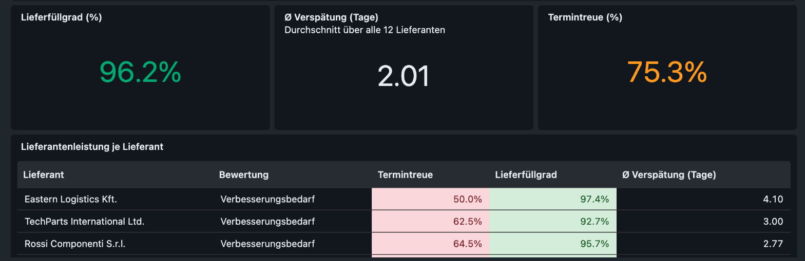
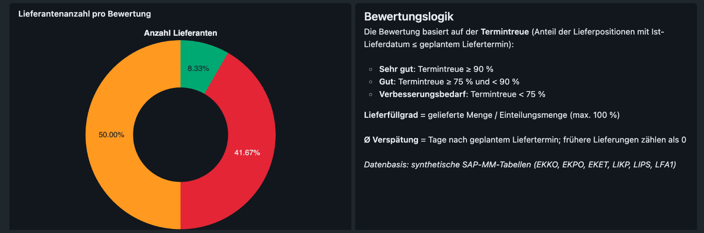

# Lieferantenleistung im Überblick – Supplier Performance on Databricks

PySpark pipeline and AI/BI dashboard that score 12 suppliers on delivery performance, built on synthetic SAP MM procurement data in Databricks (Free Edition).

**Stack:** Databricks · PySpark · Delta Lake · Unity Catalog · Databricks SQL · AI/BI Dashboards

## Kurzfassung (DE)

Aus synthetischen SAP-MM-Tabellen (Bestellungen, Einteilungen, Lieferungen, Lieferantenstamm) berechnet ein PySpark-Notebook pro Lieferant **Termintreue**, **Lieferfüllgrad** und **Ø Verspätung**, leitet daraus eine regelbasierte **Lieferantenbewertung** ab und schreibt das Ergebnis als Delta-Tabelle. Ein AI/BI-Dashboard visualisiert die Kennzahlen mit globalen Filtern nach Bewertung und Lieferant.

## Data

Seven synthetic tables modelled on SAP MM, stored as Delta tables in `workspace.default`:

| Table | SAP object | Used fields |
|---|---|---|
| `ekko_po_header` | EKKO – purchase order header | `EBELN`, `LIFNR` |
| `ekpo_po_item` | EKPO – purchase order item | `EBELN`, `EBELP`, `MENGE` |
| `eket_schedule_lines` | EKET – schedule lines | `MENGE` (scheduled qty), `EINDT` (planned date) |
| `lips_delivery_item` | LIPS – delivery item | `VBELN`, `EBELN`, `EBELP`, `LFIMG` (delivered qty) |
| `likp_delivery_header` | LIKP – delivery header | `VBELN`, `WADAT_IST` (actual delivery date) |
| `lfa_1_vendor_master` | LFA1 – vendor master | `LIFNR`, `NAME1` |
| `mara_material_master` | MARA – material master | not used yet |

## Pipeline

[`notebooks/Supplier_Performance.py`](notebooks/Supplier_Performance.py)

1. **Read source tables** with `spark.table` and select/rename the needed columns.
2. **Join** PO items → PO header (supplier) → schedule lines → delivery items → delivery header, on `EBELN`/`EBELP` and `VBELN`.
3. **Clean**: strip non-numeric characters from quantities and cast to `double`; drop rows with missing or invalid quantities or dates; deduplicate on `EBELN`, `EBELP`, `VBELN`.
4. **Line-level KPIs**:
   - `on_time_flag` = actual delivery date ≤ planned date
   - `delay_days` = days after the planned date, early deliveries clipped to 0
   - `fill_rate` = delivered / scheduled quantity, capped at 1.0
5. **Aggregate per supplier** (`groupBy LIFNR`), join supplier names from LFA1.
6. **Rate suppliers** on on-time rate:

   | Bewertung | Termintreue |
   |---|---|
   | Sehr gut | ≥ 90 % |
   | Gut | ≥ 75 % and < 90 % |
   | Verbesserungsbedarf | < 75 % |

7. **Write** the result to the Delta table `supplier_performance_gold` (overwrite).

## Dashboard

[`dashboard/Lieferantenleistung.lvdash.json`](dashboard/Lieferantenleistung.lvdash.json) is the exported AI/BI dashboard definition; the queries behind each widget are in [`sql/dashboard_queries.sql`](sql/dashboard_queries.sql).

- KPI tiles: Lieferfüllgrad, Ø Verspätung (Tage), Termintreue, colour-coded with the same thresholds as the rating
- Bar chart: average delay per supplier, sorted descending
- Table: all KPIs per supplier with conditional formatting, sorted by delay
- Pie chart: number of suppliers per rating, plus a text panel explaining the rating rules
- Global filters: Bewertung and Lieferant (multi-select)

## Results

- Ø Termintreue 75.3 %, Ø Lieferfüllgrad 96.2 %, Ø Verspätung 2.01 days (unweighted averages across suppliers)
- 1 supplier rated *Sehr gut*, 6 *Gut*, 5 *Verbesserungsbedarf*
- Fill rates are high across the board (≥ 92 %); the differences between suppliers come from timeliness, not quantity

## Limitations and next steps

- Bronze and silver steps run in memory inside the notebook; only the gold table is persisted. Next: write bronze/silver Delta tables.
- The notebook runs manually. Next: schedule it as a Databricks Job.
- Dashboard KPI tiles average the per-supplier values, so every supplier counts equally regardless of delivery volume.
- The gold table has no date or material dimension, so the dashboard can't filter by period or category yet. Next: keep `EINDT` and `MATKL` (via MARA) in the output.

## Reproduce

1. Load the seven tables into `workspace.default` in a Databricks workspace.
2. Import and run `notebooks/Supplier_Performance.py`.
3. Import `dashboard/Lieferantenleistung.lvdash.json` via **Dashboards → Create → Import dashboard from file** and attach a SQL warehouse.
