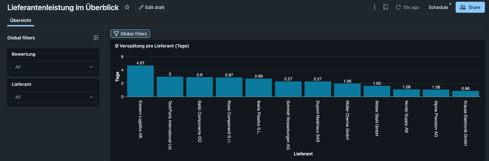

# Lieferantenleistung im Überblick – Supplier Performance on Databricks

Medallion pipeline (bronze → silver → gold) in PySpark and an AI/BI dashboard that score 12 suppliers on delivery performance, built on synthetic SAP MM procurement data in Databricks (Free Edition) and scheduled as a daily Databricks Job.

**Stack:** Databricks · PySpark · Delta Lake · Unity Catalog Volumes · Databricks Jobs · Databricks SQL · AI/BI Dashboards

## Kurzfassung (DE)

Ein täglich geplanter Databricks Job lädt synthetische SAP-MM-Daten (Bestellungen, Einteilungen, Lieferungen, Lieferantenstamm) als CSV aus einem Unity-Catalog-Volume in Bronze-Tabellen, ordnet in Silver jede Lieferposition ihrer Einteilung zu und berechnet in Gold pro Lieferant **Termintreue**, **Lieferfüllgrad** und **Ø Verspätung** samt regelbasierter **Lieferantenbewertung**. Ein AI/BI-Dashboard visualisiert die Kennzahlen mit globalen Filtern nach Bewertung und Lieferant.

## Data

I generated the data myself: seven synthetic tables modelled on SAP MM (field names and key formats follow the SAP tables, values are invented). They are in [`data/`](data/) as semicolon-separated CSVs (120 purchase orders, 325 PO items, 371 schedule lines, 341 deliveries, 12 suppliers, 16 materials).

| File | SAP table | Used fields |
|---|---|---|
| `EKKO_PO_HEADER.csv` | EKKO – purchase order header | `EBELN`, `LIFNR` |
| `EKPO_PO_ITEM.csv` | EKPO – purchase order item | `EBELN`, `EBELP`, `MATNR`, `MATKL`, `LOEKZ` |
| `EKET_SCHEDULE_LINES.csv` | EKET – schedule lines | `ETENR`, `EINDT` (planned date), `MENGE` (scheduled qty), `WEMNG` (goods-receipt qty) |
| `LIKP_DELIVERY_HEADER.csv` | LIKP – delivery header | `VBELN`, `WADAT_IST` (actual delivery date) |
| `LIPS_DELIVERY_ITEM.csv` | LIPS – delivery item | `VBELN`, `POSNR`, `EBELN`, `EBELP`, `LFIMG` (delivered qty) |
| `LFA1_VENDOR_MASTER.csv` | LFA1 – vendor master | `LIFNR`, `NAME1` |
| `MARA_MATERIAL_MASTER.csv` | MARA – material master | loaded to bronze, not used yet |

## Pipeline

[`notebooks/Supplier_Performance.py`](notebooks/Supplier_Performance.py) runs as the Databricks Job `supplier_performance_pipeline` (serverless, daily at 06:00 Europe/Berlin; definition in [`jobs/supplier_performance_pipeline.json`](jobs/supplier_performance_pipeline.json)).

| Layer | Delta tables | What happens |
|---|---|---|
| Landing | Volume `/Volumes/workspace/default/sap_raw` | The seven CSV files |
| Bronze | `bronze_ekko`, `bronze_ekpo`, `bronze_eket`, `bronze_likp`, `bronze_lips`, `bronze_lfa1`, `bronze_mara` | CSVs loaded as-is, all columns as strings (keeps SAP leading zeros), plus `_source_file` and `_ingested_at` |
| Silver | `supplier_perf_silver` | One row per delivery item: typed, matched to its schedule line, joined to PO item and supplier, validated, with line-level KPIs |
| Gold | `supplier_performance_gold` | One row per supplier: on-time rate, fill rate, average delay, rating, number of delivery items |

**Line-level KPIs (silver)**
- `on_time_flag` = actual delivery date (`WADAT_IST`) ≤ planned date (`EINDT`)
- `delay_days` = days after the planned date, early deliveries count as 0
- `fill_rate` = delivered / scheduled quantity, capped at 1.0

**Rating (gold)**, based on the on-time rate:

| Bewertung | Termintreue |
|---|---|
| Sehr gut | ≥ 90 % |
| Gut | ≥ 75 % and < 90 % |
| Verbesserungsbedarf | < 75 % |

### Matching deliveries to schedule lines

LIPS references the PO item (`EBELN`/`EBELP`) but not the schedule line (`ETENR`). In this data, 46 PO items have two schedule lines and 41 have two deliveries. Joining EKET and LIPS on `EBELN`/`EBELP` alone pairs every delivery with every schedule line of its item (2 × 2 = 4 rows for 40 items), and the first version of this pipeline then kept an arbitrary schedule line per delivery via `dropDuplicates`. That compared some deliveries against the wrong planned date and quantity.

The pipeline now matches each delivery to the schedule line of the same item whose goods-receipt quantity (`EKET.WEMNG`) equals the delivered quantity (`LIPS.LFIMG`). That holds for exactly one schedule line for all 341 deliveries, and the notebook stops with an error if any delivery matches zero or several schedule lines. Fixing it lowered the on-time rate for 9 of 12 suppliers (average 75.3 % → 71.8 %) and moved Dupont Matériaux SAS from *Gut* to *Verbesserungsbedarf*.

### Data quality checks

- Every bronze file must contain rows.
- Every delivery item must match exactly one schedule line.
- Joining PO item and PO header must not change the number of delivery items.
- Rows dropped by validity filters (missing dates, non-positive quantities) are counted and logged; currently 1 delivery without an actual delivery date.

## Dashboard

[`dashboard/Lieferantenleistung.lvdash.json`](dashboard/Lieferantenleistung.lvdash.json) is the exported AI/BI dashboard definition; the queries behind each widget are in [`sql/dashboard_queries.sql`](sql/dashboard_queries.sql).

- KPI tiles: Lieferfüllgrad, Ø Verspätung (Tage), Termintreue, colour-coded with the same thresholds as the rating
- Bar chart: average delay per supplier, sorted descending
- Table: all KPIs per supplier with conditional formatting, sorted by delay
- Pie chart: number of suppliers per rating, plus a text panel explaining the rating rules
- Global filters: Bewertung and Lieferant (multi-select)

## Results

- Ø Termintreue 71.8 %, Ø Lieferfüllgrad 97.2 %, Ø Verspätung 2.27 days (unweighted averages across suppliers)
- 1 supplier rated *Sehr gut*, 5 *Gut*, 6 *Verbesserungsbedarf*
- Fill rates are high across the board (≥ 93 %); the differences between suppliers come from timeliness, not quantity

## Limitations and next steps

- Every layer is a full overwrite on each run; there is no incremental loading (e.g. Auto Loader or `MERGE`) yet.
- The delivery-to-schedule-line match relies on goods-receipt quantity equalling delivered quantity, which holds in this synthetic data. Real SAP data would need the actual reference (e.g. via the PO history in EKBE).
- Schedule lines that were never delivered (`WEMNG` = 0) are not counted against the supplier yet.
- Dashboard KPI tiles average the per-supplier values, so every supplier counts equally regardless of delivery volume.
- The dashboard reads only the gold table, so it can't filter by period or material group yet, although silver has `planned_date` and `MATKL`.

## Reproduce

1. In a Databricks workspace, create a volume and upload the CSVs from `data/`:
   `CREATE VOLUME IF NOT EXISTS workspace.default.sap_raw;`
2. Import `notebooks/Supplier_Performance.py` and run it, or create the Job from `jobs/supplier_performance_pipeline.json` (adjust `notebook_path`).
3. Import `dashboard/Lieferantenleistung.lvdash.json` via **Dashboards → Create → Import dashboard from file** and attach a SQL warehouse.

## License

[MIT](LICENSE)
